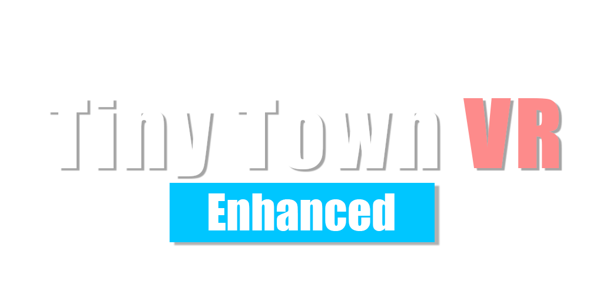
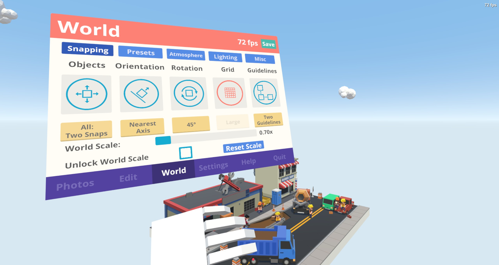
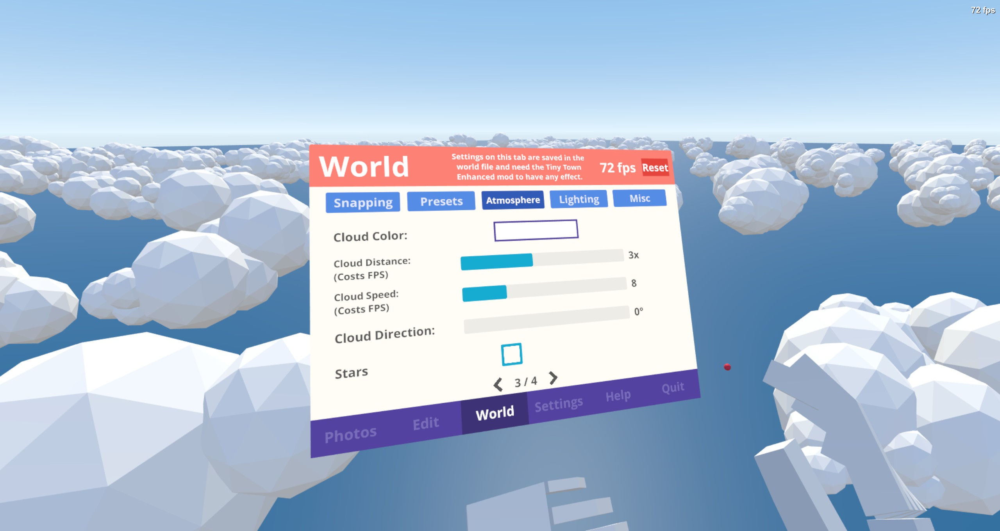
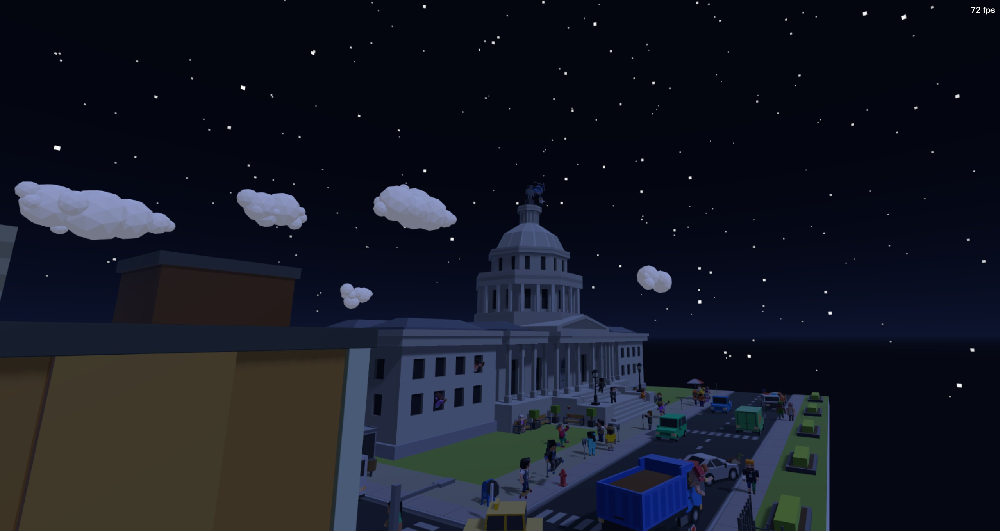
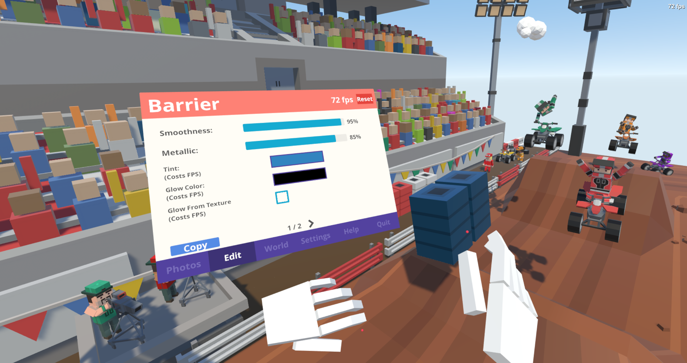

 
**TTVR Enhanced** is an overhaul to the VR game Tiny Town that adds a ton of new features, fixes and improvements.

My goal with this mod was to fix a bunch of the major issues with the base game as well as expanding on areas of the game that had little or no depth to them while keeping the original feel of the game.

# Installation

**REQUIRES [BepInEx v5](https://github.com/BepInEx/BepInEx)**

Download the latest `Win64 BepInEx 5` and extract the zip contents into the game folder.  
   
Download the latest `Tiny Town Enhanced` archive from releases and extract the contents into the game folder as well.

Run the game. The help panel on the left in the main menu should read **Tiny Town VR Enhanced \<Version\>**.

**Thanks to the BepInEx team\!**

# Changes and Additions
- Processing Workshop Items, the 300 item limit and Workshop items not being removed are all fixed.
- Group Tool: select objects with a brush to move, copy, delete or edit them together, and make groups that are saved with the world.
- World Select and Create World overhaul: rename, duplicate, custom thumbnails and export/import saves. Workshop and default worlds can be used as templates.
- Missing items: option to auto-subscribe to missing Workshop items when loading a world.
- Saving: autosave, manual save from the wrist menu, and backups.
- World and item properties: sky, atmosphere, lighting, stars, moving clouds, and item emission, colour tint, transparency and more.
- Placement: scale ground pieces, ignore copy collision, copy up and down, and head-based scale.
- World scale: unlockable, from 0.01x to 100x.
- Build menu: search, sorting, author filter, arrow navigation and Workshop author names.
- Expanded settings: stick movement options, video settings and movement vignette, Fix Oculus Controls for Quest and Rift through SteamVR.
- In-game Help pages for every mod feature, plus a changelog.
- Vanilla compatible: worlds edited with the mod still work in the vanilla game.
- And more.

# Gallery

# Disclaimer

**Claude** was used in the making of this mod. This mod is mostly vibe coded as a test and also because im a big stupid and not a programer, I ran a bunch of tests to make sure this was as bug free as possible and doesn't effect the performance of the vanilla game, obviously some of the mod settings affect performance due to how they work but vanilla settings should be fine. That being said if anyone smarter than me wants to use any of this code, use it how you like no credit or permission needed its basically not my code anyway lol.
